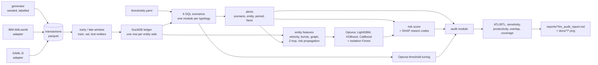

# transaction-monitoring-models

A small lab for transaction monitoring (AML): rule scenarios in SQL on DuckDB, a machine-learning scoring layer, and an audit module that tests the thresholds the way an internal auditor would. The audit module does above/below-the-line sampling, sensitivity curves, productivity, overlap and coverage.

This is a personal learning project. It has not been used in any institution.

## Why I built this

I work in internal audit analytics, and the question I hear most about monitoring is "why is the threshold where it is, and what are we missing below it?" Most public AML projects stop at a classifier. I wanted to build the rules, the model and the audit tests together, and check each audit method against known ground truth.

## Headline result

I built three evaluations of the same pipeline: my seeded generator, IBM AMLworld HI-Small, and SAML-D (Oztas et al., 2023). On each, the rules run at their default thresholds, the ML layer is tuned with Optuna (LightGBM, XGBoost, CatBoost), and rule thresholds are tuned separately on a tuning split. Everything is scored on entities the fitting never saw. On the two public datasets the test is also out-of-time: models and thresholds are fitted on the earlier half of the transactions (split at the median timestamp) and scored on the later half.

| Held-out test | My generator | IBM HI-Small | SAML-D |
|---|---|---|---|
| Test entities (suspicious) | 762 (37, 4.9%) | 75,046 (844, 1.1%) | 125,163 (901, 0.7%) |
| Rules as run: alerted entities | 72 | 6,403 | 4,710 |
| Rules as run: recall / precision | 73.0% / 37.5% | 18.8% / 2.5% | 26.0% / 5.0% |
| Rules, thresholds tuned at the same alert volume: recall / precision | 78.4% / 45.3% | 19.1% / 2.4% | 26.3% / 5.3% |
| Model PR-AUC (95% bootstrap interval) | 0.953 (0.896 to 0.991) | 0.317 (0.287 to 0.354) | 0.988 (0.983 to 0.993) |
| Model ROC-AUC | 0.996 | 0.875 | 0.999 |
| Rules as run, PR-AUC | 0.287 | 0.014 | 0.018 |
| LightGBM with default parameters, PR-AUC | 0.889 | 0.183 | 0.635 |
| Reviews the model needs to match the rules' recall | 28 instead of 72 | 183 instead of 6,403 | 234 instead of 4,710 |
| Review reduction at equal recall (95% interval) | 61% (50% to 73%) | 97% (96% to 98%) | 95% (94% to 96%) |
| Model recall when it reviews as many entities as the rules alert | 97.3% | 61.8% | 99.8% |

Before this round the README reported PR-AUC 0.905 (generator) and 0.333 (IBM) from random 5-fold out-of-fold predictions on the whole period with an untuned HistGradientBoosting model, and rules at 79.1% recall on the generator and 28.2% on IBM. Those numbers came from a weaker protocol: entities were split at random and labels used the whole period. The table above is the stricter one. The IBM PR-AUC fell slightly (0.333 to 0.317) even though the model is tuned and has more features, because it is now scored on a later period; the base rate is also different (0.5% of entities are positive in the earlier window, 1.1% in the later one, and PR-AUC rises with the base rate).

The generator stays in the repo because it has labelled typologies and evasive variants, which is what lets me check the audit methods. IBM AMLworld and SAML-D are simulations too: independent of my code, but not bank data.

### What transfers across the three datasets

| Question | Generator | IBM | SAML-D |
|---|---|---|---|
| Do the default rules suit the data? | Yes: they were written against it (73% recall) | No: pass-through alone alerts on 8% of accounts | No: structuring never fires, the rest catch 26% in total |
| Does a tuned model beat the rules at equal recall? | Yes, 61% fewer reviews | Yes, 97% fewer | Yes, 95% fewer |
| Does tuning the rule thresholds help? | Yes: +5 points recall and +8 points precision at the same volume | No measurable change | No measurable change |
| Does tuning the model help? | PR-AUC 0.889 to 0.953 | 0.183 to 0.317 | 0.635 to 0.988 |
| Do the new features help (default LightGBM, validation PR-AUC)? | No: 0.888 for the base set, 0.870 with all | 0.161 to 0.182 | 0.757 to 0.990 |
| Evasive variants | Exist by construction | Not labelled | Not labelled |

What carries over is the ranking: a supervised model orders accounts far better than any single threshold rule, and the gap is large on all three. What does not carry over is the absolute level. The rules look decent on my generator because I wrote both. On the public sets they find a fifth to a quarter of the suspicious accounts, and re-tuning them on an earlier period does not change that. The 0.99 PR-AUC on SAML-D says more about the simulator than about banks: its laundering accounts have few counterparties and sit in recognisable sub-graphs, so uniq_cp and the 2-hop path counts carry most of the signal (permutation importances 0.77, 0.13 and 0.12). The 2-hop and propagation features are worth +0.23 PR-AUC there, +0.02 on IBM, and nothing on the generator, whose typologies are single-account patterns.

## Data

| | |
|---|---|
| Synthetic sample (committed) | `src/tm_lab/generator.py`, seed 42. `data/sample/`: 254,912 transactions, 2,500 accounts, 270 days, 115 labelled suspicious entities (4.6%). MIT, same as this repo. |
| IBM AMLworld HI-Small (not committed) | 5,078,345 transactions between 2022-09-01 and 2022-09-18 (nearly all of them in the first ten days), 515,088 accounts. Kaggle: `ealtman2019/ibm-transactions-for-anti-money-laundering-aml`. Community Data License Agreement, Sharing, Version 1.0 (CDLA-Sharing-1.0), checked 2026-10-28. |
| SAML-D (not committed) | 9,504,852 transactions between 2022-10-07 and 2023-08-23, 855,460 accounts, 9,873 flagged transactions, 17 laundering and 11 normal typologies. Kaggle: `berkanoztas/synthetic-transaction-monitoring-dataset-aml`. CC BY-NC-SA 4.0, so it stays out of the repo and is for non-commercial use. |

Citations:

- Altman, Blanuša, von Niederhäusern, Egressy, Luksic, Bénézit. "Realistic Synthetic Financial Transactions for Anti-Money Laundering Models", NeurIPS 2023 Datasets and Benchmarks, [arXiv:2306.16424](https://arxiv.org/abs/2306.16424).
- Oztas, Cetinkaya, Adedoyin, Budka, Dogan, Aksu. "Enhancing Anti-Money Laundering: Development of a Synthetic Transaction Monitoring Dataset", 2023 (the SAML-D paper).

How the public datasets are used (`src/tm_lab/ibm.py`, `src/tm_lab/saml.py`):

- An account is labelled suspicious in a window if it touches a transaction flagged as laundering in that window. That includes counterparties of laundering transactions, so labels are looser than "account run by a launderer". SAML-D labels carry the typology name, so recall can be reported per typology.
- IBM has no country or customer-segment fields, so only the structuring, pass-through, fan and round-trip scenarios can fire. SAML-D has bank locations, so the high-risk jurisdiction scenario runs with six countries (Albania, Morocco, Nigeria, Pakistan, Turkey, UAE). I took them from the FATF increased-monitoring list at the start of the data period, without looking at labels. Dormant fires on seven accounts.
- I used all rows of both datasets. SAML-D was not subsampled by accounts; `tm-lab convert-saml --account-frac` exists for smaller machines.
- Accounts with more than 2,000 transactions in a window (hubs) are left out of the feature table because they make the pass-through self-join quadratic. The fan scenario already excludes them. SAML-D has none above the cap; IBM has about 15.
- Amounts are in mixed currencies and unscaled in both. The IBM currency-mismatch flag is the `is_cross_border` field.
- The IBM download uses Kaggle's public endpoint and `remotezip` (`tm-lab fetch-ibm`). SAML-D needs a Kaggle login: download the zip yourself and put `SAML-D.csv` in `data/raw/saml/`.

The synthetic generator exists because typologies such as structuring under a reporting line or dormant-account wake-ups are not labelled in public data. It injects, with labels:

- structuring, rapid pass-through (24 to 48 h), fan-in and fan-out, round-tripping, dormant wake-up, and high-risk jurisdiction counterparties;
- normal background: weekday and Nov/Dec seasonality, salary and rent, card spend, P2P, affluent customers with larger amounts;
- hard negatives that look suspicious but are not: merchants with many payers, payment processors, cash-intensive shops depositing under the line, property or inheritance windfalls, wedding gifts, regular remittances;
- an evasive variant of each typology that sits just under the default thresholds. This is what makes the below-the-line audit meaningful.

Country codes are placeholders (`DM` domestic, `F1` to `F6` foreign, `H1` to `H3` high-risk). Amounts are in one notional currency.

## Evaluation design

- Windows. The public datasets are split at the median transaction time. Everything fitted (models, isolation forest, blend weights, rule thresholds) uses the earlier window; reported numbers use the later window. The generator has no meaningful time order for its injected cases, so it uses one window.
- Entities. A hash of the account id puts each entity in train (60%), validation (20%) or test (20%; 30% on the generator) for good. Test entities are never used for fitting, and the test window comes after the fitting window.
- Features. Computed per window from that window's transactions: velocity, amounts, diversity, cross-border, bursts (Goh-Barabasi burstiness and gap CV of inter-arrival times, busiest hour and day), graph structure (degree, PageRank, short-cycle membership, 2-hop path counts, reciprocal links, directed triangles) and risk propagation (share of counterparties, amount-weighted and 2-hop diffused, that raised a rule alert). Propagation uses rule alerts only. It does not use labels, because an account is labelled by touching a flagged transaction, so a label-based neighbour feature would just restate the label.
- Models. Optuna TPE, 300 to 360 seconds per library on IBM and 200 seconds on SAML-D, maximising validation PR-AUC on a negative-downsampled training set. The validation split picks between the three libraries and their rank-average blend. The chosen model is refit on train plus validation and scored once on the test entities. Intervals are 95% percentile bootstraps over test entities (300 to 1,000 resamples). For review reduction, the rules' recall is recomputed in every resample.
- Rules. For each scenario, Optuna searches its thresholds for the most suspicious entities caught on the tuning entities, subject to an alert budget: the scenario's own alert volume at the current thresholds ("same volume") or a quarter of it ("lean"). The reporting line stays fixed. Any single configuration that runs longer than 40 seconds counts as infeasible.
- Risk score. A convex blend of the model rank, isolation-forest rank and rule hits, with weights picked on validation. All three datasets chose model weight 1.0, so the combined score equals the model score.

The parameters of every search are committed in `reports/<dataset>/tuned_params.json`; `tm-lab evaluate --params` replays them without searching.

## Architecture



## Scenarios

Thresholds live in `src/tm_lab/thresholds.yaml`. Copy it and pass `--config` to change them. Each scenario emits `scenario_id`, `entity`, `period_start`, `period_end` and a JSON `facts` column.

| Typology | Scenario | Module | Default rule |
|---|---|---|---|
| Structuring | TM-01-STRUCT | `scenarios/structuring.py` | >= 4 cash deposits in [80% x T, T) within 7 days, total >= T (T = 10,000) |
| Rapid pass-through | TM-02-PASSTHRU | `scenarios/passthrough.py` | >= 2 credits >= 3,000 in 30 days, each >= 90% forwarded within 48 h |
| Fan-in / fan-out | TM-03-FAN | `scenarios/fan.py` | >= 10 distinct counterparties in 7 days, total >= 5,000, and >= 50% moves on (or was funded beforehand) |
| Round-tripping | TM-04-ROUNDTRIP | `scenarios/roundtrip.py` | 2 to 4 hop loop back to the origin within 10 days, hop amounts within 10% |
| Dormant account | TM-05-DORMANT | `scenarios/dormant.py` | silent >= 90 days, then >= 5 transactions and >= 15,000 within 14 days |
| High-risk jurisdiction | TM-06-HIGHRISK | `scenarios/high_risk.py` | >= 2 transactions and >= 20,000 with listed countries in 30 days |

## Quickstart

```bash
python3.12 -m venv .venv && source .venv/bin/activate
pip install -e ".[dev]"      # on macOS, LightGBM and XGBoost need `brew install libomp`

tm-lab generate             # data/sample (seeded; --accounts, --days, --seed)
tm-lab evaluate --window none --out outputs/synthetic --tune-seconds 60 --rule-seconds 20
tm-lab audit --source synthetic --out outputs/synthetic --reports reports/synthetic --docs docs/synthetic

pytest -q && ruff check . && ruff format --check .
```

`tm-lab run-scenarios` runs the default rules over the whole period and prints per-scenario precision and recall. `tm-lab evaluate` does the windowed protocol above and writes scores, metrics, tuned parameters and window alerts to `--out`. `--stage models` and `--stage rules` run the two long searches separately; `--params` replays stored results.

IBM AMLworld (features take a few minutes per window on a 10-core laptop; the searches add about 20 minutes):

```bash
pip install -e ".[ibm]"
tm-lab fetch-ibm            # downloads HI-Small_Trans.csv (476 MB) and converts it
tm-lab evaluate --data data/raw/ibm_lab --config config/ibm_amlworld.yaml --out outputs/ibm \
                --tune-seconds 300 --rule-seconds 30
tm-lab audit --data data/raw/ibm_lab --config config/ibm_amlworld.yaml --out outputs/ibm --source ibm \
             --reports reports/ibm --docs docs/ibm
```

SAML-D (put `SAML-D.csv` in `data/raw/saml/` first):

```bash
tm-lab convert-saml         # data/raw/saml_lab
tm-lab evaluate --data data/raw/saml_lab --config config/saml_d.yaml --out outputs/saml \
                --tune-seconds 200 --rule-seconds 45
tm-lab audit --data data/raw/saml_lab --config config/saml_d.yaml --out outputs/saml --source saml \
             --reports reports/saml --docs docs/saml
```

Reports: [`reports/synthetic/`](reports/synthetic/tm_audit_report.md), [`reports/ibm/`](reports/ibm/tm_audit_report.md), [`reports/saml/`](reports/saml/tm_audit_report.md). CI never downloads data; the tests generate a small synthetic set. The committed numbers depend on wall-clock-limited searches, so a fresh search lands near them rather than on them; replaying `tuned_params.json` is exact for the models.

## Results on IBM AMLworld HI-Small

Later window (from 2022-09-05 12:16), 75,046 held-out test entities, 844 suspicious (1.1%). Thresholds are the defaults with three changes in `config/ibm_amlworld.yaml`: fan scenario at 8 counterparties without hub accounts, round-trips limited to 3 hops, and an empty high-risk country list.

| Scenario | Alerted test entities | Precision |
|---|---|---|
| TM-01-STRUCT | 191 | 1.0% |
| TM-02-PASSTHRU | 6,213 | 2.4% |
| TM-03-FAN | 138 | 18.8% |
| TM-04-ROUNDTRIP | 49 | 18.4% |
| All rules | 6,403 (8.5%) | 2.5%, recall 18.8% |

Model, test entities:

| Model | PR-AUC | Validation PR-AUC | Search trials |
|---|---|---|---|
| Rules as run (binary) | 0.014 | | |
| Isolation Forest | 0.024 | | |
| LightGBM, default parameters | 0.183 | | |
| LightGBM, tuned | 0.311 | 0.211 | 23 |
| XGBoost, tuned | 0.304 | 0.212 | 48 |
| CatBoost, tuned | 0.309 | 0.202 | 24 |
| Blend of the three (picked on validation) | 0.317 (0.287 to 0.354) | 0.215 | |

- At the rules' recall (18.8%) the blend needs 183 reviews against 6,403 alerts (97% fewer, interval 96% to 98%). If it reviews the same 6,403 entities, it finds 61.8% of the suspicious ones instead of 18.8%. Reaching 50% recall takes 3,162 reviews (4.2% of entities); 80% takes 17,799.
- Rule thresholds. Tuned at the same volume, the rules alert 6,631 entities for 19.1% recall; tuned to a quarter of the volume, 2,867 entities for 6.5%. The search only managed 11 pass-through and 7 fan configurations inside the time limit, because each evaluation scans 2.5 million transactions, so those two scenarios stayed at their defaults. The tuned structuring and round-trip rules changed little.
- Features, added in order to a default LightGBM (validation PR-AUC): base and graph 0.161, burstiness 0.176, 2-hop structure 0.179, risk propagation 0.182.
- Top permutation importances: `cross_border_share` (0.168; a currency mismatch flag in this data), `entity_degree` (0.041), `cp_diversity` (0.035), `n_channels` (0.028). Reason codes are the three largest positive TreeSHAP contributions per entity, with the entity's percentile on that feature, written to `outputs/*/entity_scores.parquet`.
- A random 5-fold split inside the earlier window gives PR-AUC 0.202 for the chosen family. It is not comparable with 0.317 because the earlier window has a lower base rate (0.5%).

ATL/BTL audit on the test entities (the dataset's flags play the investigator):

| Test | Result | Truth |
|---|---|---|
| Random BTL sample, n = 200 (of 68,643 unalerted) | 2 found; estimate 686 missed (95% CI 83 to 2,447) | 685 missed (81% of all suspicious) |
| BTL sample stratified by risk score, n = 200 | estimate 515 (6 to 1,776) | 685 |
| ATL sample, n = 100 | 1 confirmed, precision 1% (95% CI 0.03% to 5%) | 2.5% |
| Top 200 unalerted entities by risk score | 117 suspicious found | 2.0 expected at random |
| Coverage of the random-sample interval, 500 draws | 99% | 95% nominal |

The random sample's interval is wide, as it should be at a 1% base rate, while ranking the unalerted entities by model score turns up 117 cases in 200 reviews.

## Results on SAML-D

Later window (from 2023-03-15), 125,163 held-out test entities, 901 suspicious (0.7%). Thresholds are the packaged defaults plus the country list in `config/saml_d.yaml`.

| Scenario | Alerted test entities | Precision |
|---|---|---|
| TM-01-STRUCT | 0 | |
| TM-02-PASSTHRU | 1,498 | 4.7% |
| TM-03-FAN | 1,034 | 4.6% |
| TM-04-ROUNDTRIP | 1,923 | 4.5% |
| TM-05-DORMANT | 7 | 14.3% |
| TM-06-HIGHRISK | 2,063 | 4.9% |
| All rules | 4,710 (3.8%) | 5.0%, recall 26.0% |

Cash deposits in SAML-D rarely approach 10,000 (99th percentile 5,600), so structuring below the line finds nothing.

| Model | PR-AUC | Validation PR-AUC | Search trials |
|---|---|---|---|
| Rules as run (binary) | 0.018 | | |
| Isolation Forest | 0.113 | | |
| LightGBM, default parameters | 0.635 | | |
| LightGBM, tuned | 0.988 | 0.991 | 32 |
| XGBoost, tuned | 0.976 | 0.991 | 66 |
| CatBoost, tuned | 0.992 | 0.991 | 16 |
| Blend of the three (picked on validation) | 0.988 (0.983 to 0.993) | 0.992 | |

- At the rules' recall (26.0%) the blend needs 234 reviews against 4,710 alerts (95% fewer). Reaching 50% recall takes 451 reviews, 90% takes 813.
- Rule thresholds. Tuning for recall at the same volume moves recall from 26.0% to 26.3% and precision from 5.0% to 5.3%. A quarter of the volume gives 19.3% recall.
- Features, added in order to a default LightGBM (validation PR-AUC): base and graph 0.757, burstiness 0.757, 2-hop structure 0.966, risk propagation 0.990.
- Permutation importance is concentrated: `uniq_cp` 0.77, `paths_out_2hop` 0.13, `risk_prop_2hop` 0.13, `paths_in_2hop` 0.12. Flagged accounts have unusual counterparty structure in this simulator.

Per-typology recall on the test entities (suspicious accounts touching that typology; rules as run, and the model when it reviews the same number of entities as the rules alert). Full table in [`reports/saml/per_typology_recall.csv`](reports/saml/per_typology_recall.csv):

| Typology | Entities | Rules | Model |
|---|---|---|---|
| Structuring | 208 | 24.0% | 100% |
| Deposit-Send | 119 | 29.4% | 100% |
| Layered_Fan_In | 71 | 33.8% | 100% |
| Layered_Fan_Out | 61 | 23.0% | 98.4% |
| Behavioural_Change_2 | 53 | 15.1% | 100% |
| Fan_In | 51 | 23.5% | 100% |
| Gather-Scatter | 43 | 25.6% | 100% |
| Behavioural_Change_1 | 41 | 17.1% | 97.6% |
| Fan_Out | 40 | 25.0% | 100% |
| Cycle | 34 | 29.4% | 100% |
| Single_large | 36 | 36.1% | 100% |

The rules are weakest on the behavioural-change typologies (15% to 17%), as expected for rules that look at a single window of activity. ATL/BTL on SAML-D: 120,453 unalerted entities, 667 suspicious among them (74% of all). A random sample of 200 found 1 (estimate 602, interval 15 to 3,318); the 200 highest-scored unalerted entities were all suspicious.

## Results on the synthetic sample (seed 42)

Test entities only: 762 entities, 37 suspicious. Models and thresholds are fitted on separate entities of the same sample.

| Scenario | Alerted entities | Precision | Recall of its own typology |
|---|---|---|---|
| TM-01-STRUCT | 13 | 30.8% | 57.1% |
| TM-02-PASSTHRU | 13 | 76.9% | 83.3% |
| TM-03-FAN | 40 | 20.0% | 87.5% |
| TM-04-ROUNDTRIP | 5 | 100% | 62.5% |
| TM-05-DORMANT | 4 | 100% | 66.7% |
| TM-06-HIGHRISK | 3 | 33.3% | 50.0% |
| All scenarios | 72 | 37.5% | 73.0% (any typology) |

| Model | Test PR-AUC | ROC-AUC |
|---|---|---|
| Rules as run (binary) | 0.287 | |
| Isolation Forest | 0.340 | 0.887 |
| LightGBM / XGBoost / CatBoost, tuned | 0.917 / 0.924 / 0.953 | |
| CatBoost (picked on validation, 0.949) | 0.953 (0.896 to 0.991) | 0.996 |
| LightGBM, default parameters | 0.889 | |

With 37 positives the intervals are wide and the three libraries are indistinguishable. At the rules' recall (73.0%) CatBoost needs 28 reviews against 72 alerts (61% fewer, interval 50% to 73%); on a random 5-fold split inside the fitting entities it scores 0.905. Tuned rule thresholds at the same volume give 64 alerts, recall 78.4% and precision 45.3%, which is the one dataset where re-tuning helped. The quarter-volume rules keep 32.4% recall at 70.6% precision.

Permutation importance on the generator is led by `n_channels` (0.23) and `risk_prop_2hop` (0.18), then `max_day_share`. That is a property of how I generate channels, not a finding about AML.


### Audit module

`tm-lab audit` writes a report per dataset: 7 findings on the public sets and 8 on the generator (the typology coverage test needs labelled typologies), each with observation, risk rating and recommendation, built from the run's numbers. The tests below are on the held-out test entities.

| Test (generator) | Result | Truth |
|---|---|---|
| Random BTL sample, n = 200 (of 690 unalerted) | 3 found; estimate 10 missed (95% CI 3 to 30) | 10 missed (27% of 37) |
| BTL sample stratified by risk score, n = 200 | estimate 10 (10 to 21) | 10 |
| ATL sample, n = 72 (all alerted) | 27 confirmed, precision 38% (95% CI 26% to 50%) | 37.5% |
| Top 200 unalerted entities by risk score | 10 suspicious found | 2.9 expected at random |

At a population of 690 the sample of 200 is a large share of the population, so these intervals are not informative about the method's behaviour; the IBM and SAML-D rows above are the realistic ones. Per-scenario BTL tests are under-powered: samples of 150 unalerted entities per scenario find few or no misses, and the zero-failure formula (`n_to_detect_at_truth` in the report) asks for many more. A clean sample is not assurance.

Threshold sensitivity (one parameter at a time, current value highlighted), productivity (alert-to-case conversion, where "case" means the alerted entity carries a label) and scenario overlap are in the reports and figures:


The coverage matrix is full on the diagonal for obvious variants. On the 37 test entities the evasive variants are caught in 0% to 33% of cases (structuring, pass-through, fan-out, dormant and high-risk 0%, round-trip 33%; no fan-in evasive case landed in the test split), which is what the below-the-line audit is for:


More figures: `docs/synthetic/`, `docs/ibm/`, `docs/saml/`.

## Layout

```
src/tm_lab/
  generator.py        seeded synthetic data with labelled typologies
  data.py             load/save, DuckDB ledger, YAML config, labels from transaction flags
  ibm.py, saml.py     adapters for the two public datasets
  windows.py          early/late windows and entity-disjoint train/val/test groups
  scenarios/          one module per typology (SQL on DuckDB)
  features.py         entity features: velocity, bursts, graph, 2-hop, risk propagation
  model.py            Optuna search, boosting libraries, isolation forest, blend, bootstrap, reason codes
  rule_tuning.py      Optuna threshold search under an alert budget
  experiment.py       the whole windowed evaluation
  audit/              sampling maths, analyses, plots, report builder
  cli.py              tm-lab generate | fetch-ibm | convert-saml | run-scenarios | evaluate | audit
tests/                scenarios, features, windows, adapters, search, bootstrap, end-to-end on a small set
config/               thresholds for the IBM and SAML-D runs
data/sample/          committed synthetic sample
reports/              audit reports, metrics, tuned parameters (one folder per dataset)
docs/                 figures (one folder per dataset)
```

## Limitations

- All three datasets are simulations. Their labels mark every account that touches a flagged transaction, and the 0.99 PR-AUC on SAML-D shows how readable simulated laundering structure can be. Do not read any of these figures as performance at a bank.
- The generator has one window, so its numbers are entity-held-out but not out-of-time. Its test set has 37 positives.
- Reviewer outcomes in the audit are dataset labels, so the ATL/BTL results are exact by construction. Real outcomes come from investigators and are noisy and late.
- Alert-to-case conversion is a proxy (the alerted entity is labelled), not a case-management funnel.
- Entity-level only: no transaction-level labels, customer risk rating, sanctions or adverse-media logic, or case management.
- IBM and SAML-D have no customer segment, and IBM has no country field, so segment-level thresholds cannot be tuned there.
- Optuna runs are limited by wall-clock time, so the number of trials differs by library and machine (the counts are in the tables above). The pass-through and fan searches on IBM were limited most.
- Country codes in the generator are placeholders and do not follow any real high-risk list.

## License

MIT, see [LICENSE](LICENSE). The IBM AMLworld data is under CDLA-Sharing-1.0 and SAML-D under CC BY-NC-SA 4.0; neither is part of this repo.

Utku Fidan, [utkufidan.com](https://utkufidan.com)
