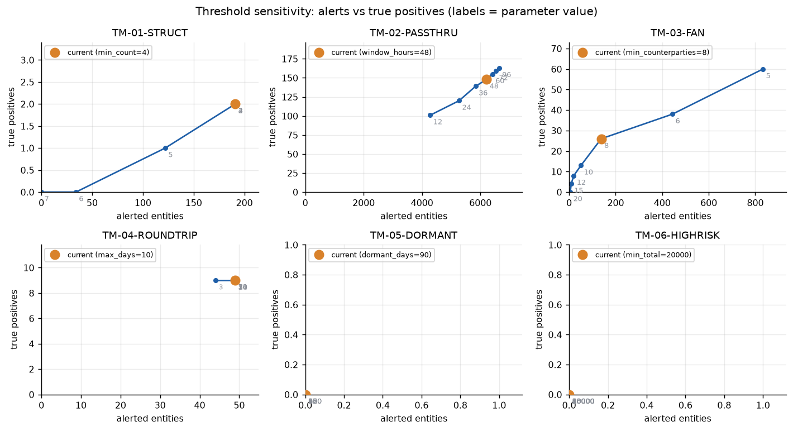
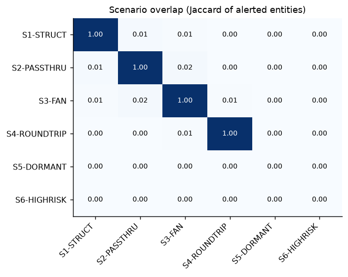
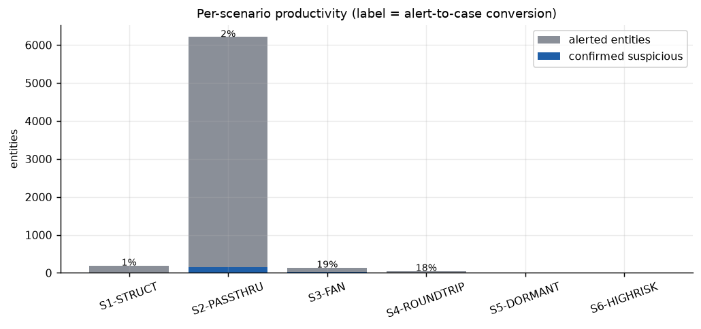
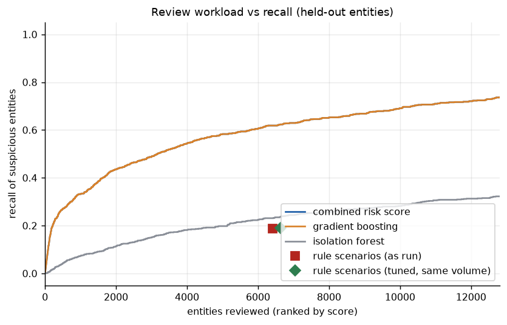
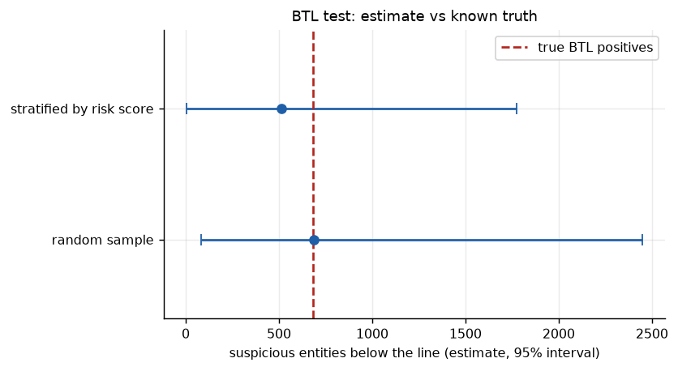

# Transaction-monitoring audit report

Generated by `tm-lab audit` from the actual run (seed 42). Data are the IBM AMLworld HI-Small simulation; reviewer outcomes are its laundering flags (an account counts as suspicious if it touches a flagged transaction in the window). None of this is an observation about a real institution.

## 1. Scope and approach

- Population: 75,046 entities in the later window (from 2022-09-05), held-out test entities only, 844 labelled suspicious (1.1%).
- Scenarios in scope: TM-01-STRUCT, TM-02-PASSTHRU, TM-03-FAN, TM-04-ROUNDTRIP, TM-05-DORMANT, TM-06-HIGHRISK. Reporting threshold 10,000.
- Procedures: per-scenario productivity, scenario overlap, one-at-a-time threshold sensitivity, above-the-line (ATL) and below-the-line (BTL) sampling, and ML challenger comparison.

## 2. Summary of findings

| ID | Rating | Finding |
|---|---|---|
| F-01 | High | Low alert-to-case conversion in selected scenarios |
| F-02 | High | Suspicious activity below the line (portfolio BTL test) |
| F-03 | Low | Threshold calibration against sensitivity curves |
| F-04 | Low | Scenario overlap and unique contribution |
| F-05 | Medium | ML scoring as a challenger to rule prioritisation |
| F-06 | Low | Rule thresholds tuned on a tuning split versus current thresholds |
| F-07 | Medium | Per-scenario BTL tests are under-powered at typical sample sizes |

## 3. Detailed findings

### F-01 Low alert-to-case conversion in selected scenarios (rating: High)

**Observation.** 4 of 4 scenarios convert fewer than half of their alerted entities into confirmed suspicious activity: TM-01-STRUCT 1% (2/191), TM-02-PASSTHRU 2% (148/6213), TM-04-ROUNDTRIP 18% (9/49), TM-03-FAN 19% (26/138). Across all scenarios 6591 entity-alerts yielded 185 confirmed (3%).

**Risk.** Analyst capacity is consumed by false positives; the institution cannot show that the threshold is a justified trade-off between workload and detection.

**Recommendation.** Segment the scenario (e.g. merchants, cash-intensive businesses) with documented rationale, re-tune against the sensitivity curves in section 3, and track conversion monthly per scenario.

### F-02 Suspicious activity below the line (portfolio BTL test) (rating: High)

**Observation.** Below-the-line population: 68643 entities with no alert. A random sample of 200 contained 2 suspicious entities, extrapolating to about 686 missed entities (95% interval 83 to 2447). A sample stratified by risk score estimates 515 (6 to 1776). The labels show the true figure is 685, i.e. 81% of all 844 suspicious entities are not alerted. Over 500 repeated random draws the interval contained the truth 99% of the time.

**Risk.** Suspicious activity that no scenario flags is invisible to the first line and to regulators' reviews; a low BTL rate in a sample is not evidence of absence when prevalence is small.

**Recommendation.** Run a BTL sample each cycle with a stratified design (more weight near the line), document sample sizes and exceptions, and feed confirmed misses into scenario tuning.

### F-03 Threshold calibration against sensitivity curves (rating: Low)

**Observation.** Settings where a different value improves F1 (precision on any suspicious entity, recall on all labelled entities) by more than 0.05: none; all current values are within 0.05 F1 of the best value on the grid. The sweep varies one parameter at a time and is evaluated on this dataset only.

**Risk.** Without documented sensitivity analysis a threshold cannot be defended to a regulator, and may sit on a steep part of the curve where small changes move alert volume sharply.

**Recommendation.** Keep the curves with each threshold decision, re-run after material data or product changes, and record who approved the chosen operating point and why.

### F-04 Scenario overlap and unique contribution (rating: Low)

**Observation.** Pairs with Jaccard >= 0.15: none. Entities alerted by only that scenario: TM-01-STRUCT 115, TM-02-PASSTHRU 6028, TM-03-FAN 34, TM-04-ROUNDTRIP 41, TM-05-DORMANT 0, TM-06-HIGHRISK 0.

**Risk.** Heavy overlap means duplicate work and overstated coverage; scenarios with no unique entities may be redundant, while unique-only scenarios carry the diversity of the programme.

**Recommendation.** Consolidate alerts per entity before case creation and review scenarios whose entire output is covered by others.

### F-05 ML scoring as a challenger to rule prioritisation (rating: Medium)

**Observation.** On held-out entities in the later window, PR-AUC is 0.32 for the tuned gradient-boosting model (95% bootstrap interval 0.29 to 0.35), 0.02 for the isolation forest, 0.32 for the combined score and 0.01 for the rules as run (prevalence 1.1%). At the rules' recall of 19% gradient boosting needs 183 reviews instead of 6403 (97% fewer, interval 96% to 98%); the combined score needs 183 (97% fewer). Reviewing the top 200 below-the-line entities by risk score finds 117 suspicious entities against 2.0 expected from random selection.

**Risk.** The model is trained on labels that, in a real bank, come from past investigations and inherit the blind spots of the rules; on simulated data the numbers are optimistic. Unexplained scores are not acceptable to model-risk or audit functions.

**Recommendation.** Deploy as a challenger and prioritisation layer first (not as a replacement), keep reason codes with every score, monitor drift, and validate on out-of-time data before any threshold is relaxed.

### F-06 Rule thresholds tuned on a tuning split versus current thresholds (rating: Low)

**Observation.** Thresholds were optimised on the earlier window's tuning entities for maximum recall within each scenario's current alert volume, then applied unchanged to the later window's held-out entities. Current thresholds alert 6403 entities (recall 19%, precision 2%). Tuned at the same volume: 6631 entities, recall 19%, precision 2%. Tuned to a quarter of the volume: 2867 entities, recall 7%, precision 2%.

**Risk.** Thresholds set by judgement and left unreviewed carry unexplained alert volume; thresholds fitted on one period can decay when behaviour shifts.

**Recommendation.** Run threshold tuning on a tuning split with a stated alert budget at each model governance cycle, confirm on a later holdout as done here, and document the chosen operating point.

### F-07 Per-scenario BTL tests are under-powered at typical sample sizes (rating: Medium)

**Observation.** With about 150 entities sampled per scenario, 2 of 6 scenarios with misses found no exception: TM-01-STRUCT (true misses 842, needs n >= 265), TM-02-PASSTHRU (true misses 696, needs n >= 295).

**Risk.** A clean BTL sample can create false assurance when the typology is rare.

**Recommendation.** State the tolerable miss rate up front and size samples with the zero-failure formula, or use risk-stratified or targeted sampling for rare typologies.

## 4. Supporting tables

### 4.1 Scenario productivity

| scenario | alerts | entities | true_positive | conversion | own_typology_hits | own_precision | own_recall |
|---|---|---|---|---|---|---|---|
| TM-01-STRUCT | 191 | 191 | 2 | 1% | 2 | 1% | 0% |
| TM-02-PASSTHRU | 6213 | 6213 | 148 | 2% | 148 | 2% | 18% |
| TM-03-FAN | 139 | 138 | 26 | 19% | 26 | 19% | 3% |
| TM-04-ROUNDTRIP | 49 | 49 | 9 | 18% | 9 | 18% | 1% |
| TM-05-DORMANT | 0 | 0 | 0 | - | 0 | - | 0% |
| TM-06-HIGHRISK | 0 | 0 | 0 | - | 0 | - | 0% |

### 4.3 Threshold sensitivity

| scenario | parameter | value | current | entities | true_positive | precision | own_recall | f1 |
|---|---|---|---|---|---|---|---|---|
| TM-01-STRUCT | min_count | 2 |  | 191 | 2 | 0.01 | 0.00 | 0.00 |
| TM-01-STRUCT | min_count | 3 |  | 191 | 2 | 0.01 | 0.00 | 0.00 |
| TM-01-STRUCT | min_count | 4 | yes | 191 | 2 | 0.01 | 0.00 | 0.00 |
| TM-01-STRUCT | min_count | 5 |  | 122 | 1 | 0.01 | 0.00 | 0.00 |
| TM-01-STRUCT | min_count | 6 |  | 34 | 0 | 0.00 | 0.00 | 0.00 |
| TM-01-STRUCT | min_count | 7 |  | 0 | 0 | 0.00 | 0.00 | 0.00 |
| TM-02-PASSTHRU | window_hours | 12 |  | 4283 | 101 | 0.02 | 0.12 | 0.04 |
| TM-02-PASSTHRU | window_hours | 24 |  | 5271 | 120 | 0.02 | 0.14 | 0.04 |
| TM-02-PASSTHRU | window_hours | 36 |  | 5837 | 139 | 0.02 | 0.16 | 0.04 |
| TM-02-PASSTHRU | window_hours | 48 | yes | 6213 | 148 | 0.02 | 0.18 | 0.04 |
| TM-02-PASSTHRU | window_hours | 60 |  | 6413 | 155 | 0.02 | 0.18 | 0.04 |
| TM-02-PASSTHRU | window_hours | 72 |  | 6532 | 159 | 0.02 | 0.19 | 0.04 |
| TM-02-PASSTHRU | window_hours | 96 |  | 6642 | 163 | 0.02 | 0.19 | 0.04 |
| TM-03-FAN | min_counterparties | 5 |  | 833 | 60 | 0.07 | 0.07 | 0.07 |
| TM-03-FAN | min_counterparties | 6 |  | 444 | 38 | 0.09 | 0.05 | 0.06 |
| TM-03-FAN | min_counterparties | 8 | yes | 138 | 26 | 0.19 | 0.03 | 0.05 |
| TM-03-FAN | min_counterparties | 10 |  | 51 | 13 | 0.25 | 0.02 | 0.03 |
| TM-03-FAN | min_counterparties | 12 |  | 20 | 8 | 0.40 | 0.01 | 0.02 |
| TM-03-FAN | min_counterparties | 15 |  | 9 | 4 | 0.44 | 0.00 | 0.01 |
| TM-03-FAN | min_counterparties | 20 |  | 5 | 0 | 0.00 | 0.00 | 0.00 |
| TM-04-ROUNDTRIP | max_days | 3 |  | 44 | 9 | 0.20 | 0.01 | 0.02 |
| TM-04-ROUNDTRIP | max_days | 5 |  | 49 | 9 | 0.18 | 0.01 | 0.02 |
| TM-04-ROUNDTRIP | max_days | 7 |  | 49 | 9 | 0.18 | 0.01 | 0.02 |
| TM-04-ROUNDTRIP | max_days | 10 | yes | 49 | 9 | 0.18 | 0.01 | 0.02 |
| TM-04-ROUNDTRIP | max_days | 14 |  | 49 | 9 | 0.18 | 0.01 | 0.02 |
| TM-04-ROUNDTRIP | max_days | 21 |  | 49 | 9 | 0.18 | 0.01 | 0.02 |
| TM-04-ROUNDTRIP | max_days | 30 |  | 49 | 9 | 0.18 | 0.01 | 0.02 |
| TM-05-DORMANT | dormant_days | 30 |  | 0 | 0 | 0.00 | 0.00 | 0.00 |
| TM-05-DORMANT | dormant_days | 45 |  | 0 | 0 | 0.00 | 0.00 | 0.00 |
| TM-05-DORMANT | dormant_days | 60 |  | 0 | 0 | 0.00 | 0.00 | 0.00 |
| TM-05-DORMANT | dormant_days | 75 |  | 0 | 0 | 0.00 | 0.00 | 0.00 |
| TM-05-DORMANT | dormant_days | 90 | yes | 0 | 0 | 0.00 | 0.00 | 0.00 |
| TM-05-DORMANT | dormant_days | 120 |  | 0 | 0 | 0.00 | 0.00 | 0.00 |
| TM-05-DORMANT | dormant_days | 150 |  | 0 | 0 | 0.00 | 0.00 | 0.00 |
| TM-06-HIGHRISK | min_total | 5000 |  | 0 | 0 | 0.00 | 0.00 | 0.00 |
| TM-06-HIGHRISK | min_total | 10000 |  | 0 | 0 | 0.00 | 0.00 | 0.00 |
| TM-06-HIGHRISK | min_total | 15000 |  | 0 | 0 | 0.00 | 0.00 | 0.00 |
| TM-06-HIGHRISK | min_total | 20000 | yes | 0 | 0 | 0.00 | 0.00 | 0.00 |
| TM-06-HIGHRISK | min_total | 30000 |  | 0 | 0 | 0.00 | 0.00 | 0.00 |
| TM-06-HIGHRISK | min_total | 40000 |  | 0 | 0 | 0.00 | 0.00 | 0.00 |
| TM-06-HIGHRISK | min_total | 60000 |  | 0 | 0 | 0.00 | 0.00 | 0.00 |

### 4.4 Per-scenario BTL tests

| scenario | btl_population | sample | found | est_missed | est_lo | est_hi | truth_missed | n_to_detect_at_truth |
|---|---|---|---|---|---|---|---|---|
| TM-01-STRUCT | 74855 | 150 | 0 | 0.0 | 0.0 | 1818.4 | 842 | 265 |
| TM-02-PASSTHRU | 68833 | 150 | 0 | 0.0 | 0.0 | 1672.1 | 696 | 295 |
| TM-03-FAN | 74908 | 150 | 1 | 499.4 | 12.6 | 2740.4 | 818 | 273 |
| TM-04-ROUNDTRIP | 74997 | 150 | 2 | 1000.0 | 121.4 | 3549.8 | 835 | 268 |
| TM-05-DORMANT | 75046 | 150 | 1 | 500.3 | 12.7 | 2745.4 | 844 | 265 |
| TM-06-HIGHRISK | 75046 | 150 | 1 | 500.3 | 12.7 | 2745.4 | 844 | 265 |

### 4.5 Figures

---

By Utku Fidan · utkufidan.com
