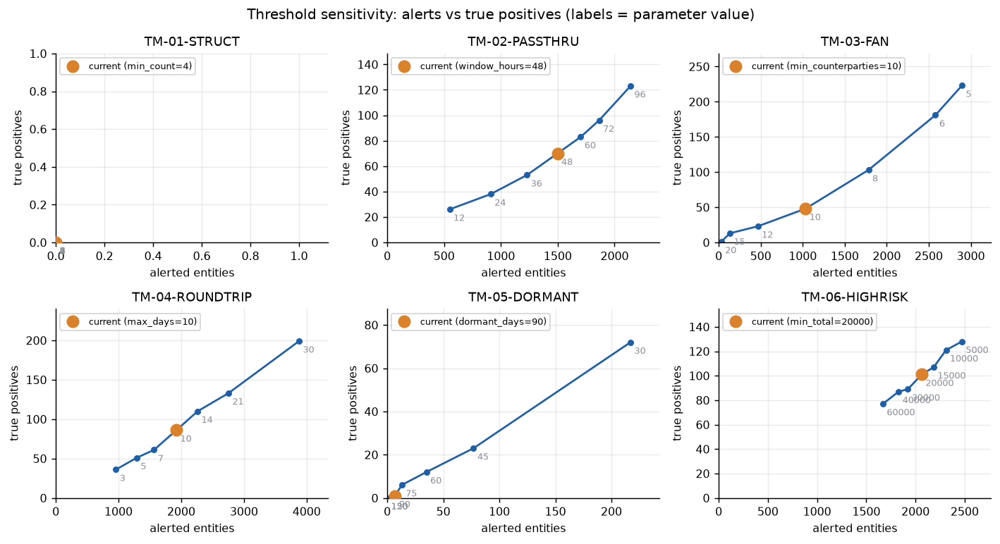
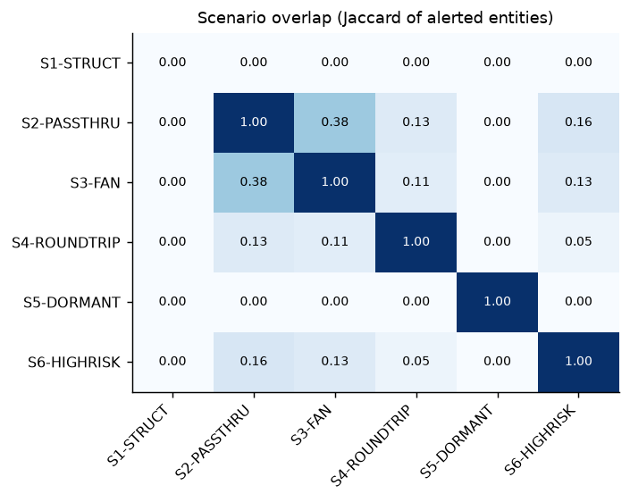
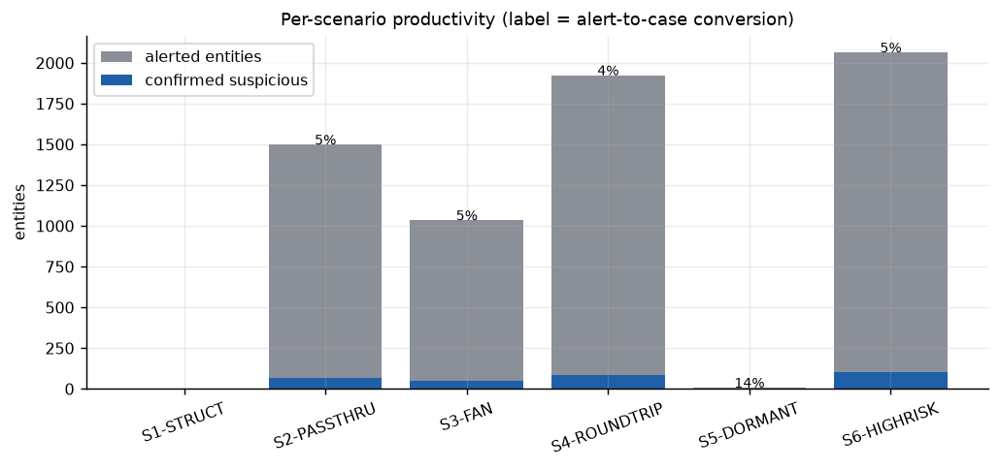
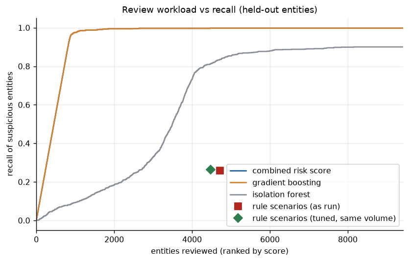
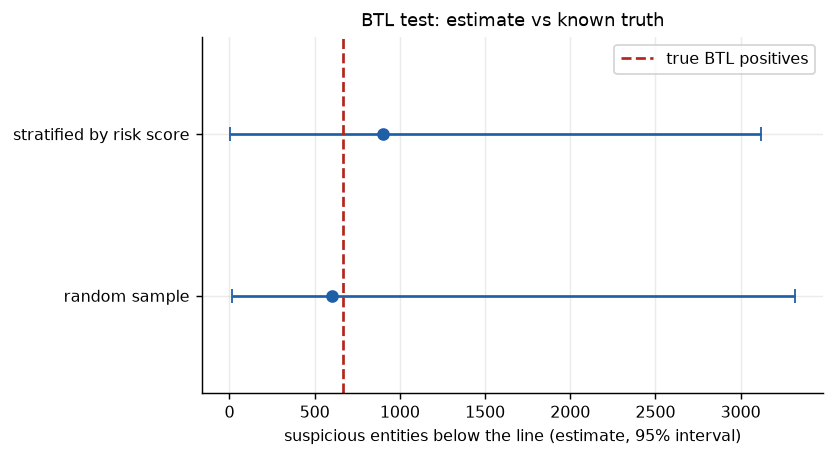

# Transaction-monitoring audit report

Generated by `tm-lab audit` from the actual run (seed 42). Data are the SAML-D simulation (Oztas et al., 2023); reviewer outcomes are its laundering flags (an account counts as suspicious if it touches a flagged transaction in the window). None of this is an observation about a real institution.

## 1. Scope and approach

- Population: 125,163 entities in the later window (from 2023-03-15), held-out test entities only, 901 labelled suspicious (0.7%).
- Scenarios in scope: TM-01-STRUCT, TM-02-PASSTHRU, TM-03-FAN, TM-04-ROUNDTRIP, TM-05-DORMANT, TM-06-HIGHRISK. Reporting threshold 10,000.
- Procedures: per-scenario productivity, scenario overlap, one-at-a-time threshold sensitivity, above-the-line (ATL) and below-the-line (BTL) sampling, and ML challenger comparison.

## 2. Summary of findings

| ID | Rating | Finding |
|---|---|---|
| F-01 | High | Low alert-to-case conversion in selected scenarios |
| F-02 | High | Suspicious activity below the line (portfolio BTL test) |
| F-03 | Medium | Threshold calibration against sensitivity curves |
| F-04 | Medium | Scenario overlap and unique contribution |
| F-05 | Medium | ML scoring as a challenger to rule prioritisation |
| F-06 | Low | Rule thresholds tuned on a tuning split versus current thresholds |
| F-07 | Low | Per-scenario BTL tests are under-powered at typical sample sizes |

## 3. Detailed findings

### F-01 Low alert-to-case conversion in selected scenarios (rating: High)

**Observation.** 5 of 5 scenarios convert fewer than half of their alerted entities into confirmed suspicious activity: TM-04-ROUNDTRIP 4% (86/1923), TM-03-FAN 5% (48/1034), TM-02-PASSTHRU 5% (70/1498), TM-06-HIGHRISK 5% (101/2063), TM-05-DORMANT 14% (1/7). Across all scenarios 6525 entity-alerts yielded 306 confirmed (5%).

**Risk.** Analyst capacity is consumed by false positives; the institution cannot show that the threshold is a justified trade-off between workload and detection.

**Recommendation.** Segment the scenario (e.g. merchants, cash-intensive businesses) with documented rationale, re-tune against the sensitivity curves in section 3, and track conversion monthly per scenario.

### F-02 Suspicious activity below the line (portfolio BTL test) (rating: High)

**Observation.** Below-the-line population: 120453 entities with no alert. A random sample of 200 contained 1 suspicious entities, extrapolating to about 602 missed entities (95% interval 15 to 3318). A sample stratified by risk score estimates 903 (6 to 3118). The labels show the true figure is 667, i.e. 74% of all 901 suspicious entities are not alerted. Over 500 repeated random draws the interval contained the truth 99% of the time.

**Risk.** Suspicious activity that no scenario flags is invisible to the first line and to regulators' reviews; a low BTL rate in a sample is not evidence of absence when prevalence is small.

**Recommendation.** Run a BTL sample each cycle with a stratified design (more weight near the line), document sample sizes and exceptions, and feed confirmed misses into scenario tuning.

### F-03 Threshold calibration against sensitivity curves (rating: Medium)

**Observation.** Settings where a different value improves F1 (precision on any suspicious entity, recall on all labelled entities) by more than 0.05: TM-03-FAN min_counterparties=10 (F1 0.05, 1034 entities, 48 TP) vs 5 (F1 0.12, 2895 entities, 223 TP); TM-05-DORMANT dormant_days=90 (F1 0.00, 7 entities, 1 TP) vs 30 (F1 0.13, 217 entities, 72 TP). The sweep varies one parameter at a time and is evaluated on this dataset only.

**Risk.** Without documented sensitivity analysis a threshold cannot be defended to a regulator, and may sit on a steep part of the curve where small changes move alert volume sharply.

**Recommendation.** Keep the curves with each threshold decision, re-run after material data or product changes, and record who approved the chosen operating point and why.

### F-04 Scenario overlap and unique contribution (rating: Medium)

**Observation.** Pairs with Jaccard >= 0.15: TM-02-PASSTHRU/TM-03-FAN 0.38, TM-02-PASSTHRU/TM-06-HIGHRISK 0.16. Entities alerted by only that scenario: TM-01-STRUCT 0, TM-02-PASSTHRU 438, TM-03-FAN 197, TM-04-ROUNDTRIP 1401, TM-05-DORMANT 7, TM-06-HIGHRISK 1391.

**Risk.** Heavy overlap means duplicate work and overstated coverage; scenarios with no unique entities may be redundant, while unique-only scenarios carry the diversity of the programme.

**Recommendation.** Consolidate alerts per entity before case creation and review scenarios whose entire output is covered by others.

### F-05 ML scoring as a challenger to rule prioritisation (rating: Medium)

**Observation.** On held-out entities in the later window, PR-AUC is 0.99 for the tuned gradient-boosting model (95% bootstrap interval 0.98 to 0.99), 0.11 for the isolation forest, 0.99 for the combined score and 0.02 for the rules as run (prevalence 0.7%). At the rules' recall of 26% gradient boosting needs 234 reviews instead of 4710 (95% fewer, interval 94% to 96%); the combined score needs 234 (95% fewer). Reviewing the top 200 below-the-line entities by risk score finds 200 suspicious entities against 1.1 expected from random selection.

**Risk.** The model is trained on labels that, in a real bank, come from past investigations and inherit the blind spots of the rules; on simulated data the numbers are optimistic. Unexplained scores are not acceptable to model-risk or audit functions.

**Recommendation.** Deploy as a challenger and prioritisation layer first (not as a replacement), keep reason codes with every score, monitor drift, and validate on out-of-time data before any threshold is relaxed.

### F-06 Rule thresholds tuned on a tuning split versus current thresholds (rating: Low)

**Observation.** Thresholds were optimised on the earlier window's tuning entities for maximum recall within each scenario's current alert volume, then applied unchanged to the later window's held-out entities. Current thresholds alert 4710 entities (recall 26%, precision 5%). Tuned at the same volume: 4475 entities, recall 26%, precision 5%. Tuned to a quarter of the volume: 3882 entities, recall 19%, precision 4%.

**Risk.** Thresholds set by judgement and left unreviewed carry unexplained alert volume; thresholds fitted on one period can decay when behaviour shifts.

**Recommendation.** Run threshold tuning on a tuning split with a stated alert budget at each model governance cycle, confirm on a later holdout as done here, and document the chosen operating point.

### F-07 Per-scenario BTL tests are under-powered at typical sample sizes (rating: Low)

**Observation.** With about 150 entities sampled per scenario, 0 of 6 scenarios with misses found no exception.

**Risk.** A clean BTL sample can create false assurance when the typology is rare.

**Recommendation.** State the tolerable miss rate up front and size samples with the zero-failure formula, or use risk-stratified or targeted sampling for rare typologies.

## 4. Supporting tables

### 4.1 Scenario productivity

| scenario | alerts | entities | true_positive | conversion | own_typology_hits | own_precision | own_recall |
|---|---|---|---|---|---|---|---|
| TM-01-STRUCT | 0 | 0 | 0 | - | 0 | - | 0% |
| TM-02-PASSTHRU | 2898 | 1498 | 70 | 5% | 70 | 5% | 8% |
| TM-03-FAN | 2261 | 1034 | 48 | 5% | 48 | 5% | 5% |
| TM-04-ROUNDTRIP | 3653 | 1923 | 86 | 4% | 86 | 4% | 10% |
| TM-05-DORMANT | 7 | 7 | 1 | 14% | 1 | 14% | 0% |
| TM-06-HIGHRISK | 2738 | 2063 | 101 | 5% | 101 | 5% | 11% |

### 4.3 Threshold sensitivity

| scenario | parameter | value | current | entities | true_positive | precision | own_recall | f1 |
|---|---|---|---|---|---|---|---|---|
| TM-01-STRUCT | min_count | 2 |  | 0 | 0 | 0.00 | 0.00 | 0.00 |
| TM-01-STRUCT | min_count | 3 |  | 0 | 0 | 0.00 | 0.00 | 0.00 |
| TM-01-STRUCT | min_count | 4 | yes | 0 | 0 | 0.00 | 0.00 | 0.00 |
| TM-01-STRUCT | min_count | 5 |  | 0 | 0 | 0.00 | 0.00 | 0.00 |
| TM-01-STRUCT | min_count | 6 |  | 0 | 0 | 0.00 | 0.00 | 0.00 |
| TM-01-STRUCT | min_count | 7 |  | 0 | 0 | 0.00 | 0.00 | 0.00 |
| TM-02-PASSTHRU | window_hours | 12 |  | 549 | 26 | 0.05 | 0.03 | 0.04 |
| TM-02-PASSTHRU | window_hours | 24 |  | 910 | 38 | 0.04 | 0.04 | 0.04 |
| TM-02-PASSTHRU | window_hours | 36 |  | 1229 | 53 | 0.04 | 0.06 | 0.05 |
| TM-02-PASSTHRU | window_hours | 48 | yes | 1498 | 70 | 0.05 | 0.08 | 0.06 |
| TM-02-PASSTHRU | window_hours | 60 |  | 1702 | 83 | 0.05 | 0.09 | 0.06 |
| TM-02-PASSTHRU | window_hours | 72 |  | 1864 | 96 | 0.05 | 0.11 | 0.07 |
| TM-02-PASSTHRU | window_hours | 96 |  | 2140 | 123 | 0.06 | 0.14 | 0.08 |
| TM-03-FAN | min_counterparties | 5 |  | 2895 | 223 | 0.08 | 0.25 | 0.12 |
| TM-03-FAN | min_counterparties | 6 |  | 2580 | 181 | 0.07 | 0.20 | 0.10 |
| TM-03-FAN | min_counterparties | 8 |  | 1783 | 103 | 0.06 | 0.11 | 0.08 |
| TM-03-FAN | min_counterparties | 10 | yes | 1034 | 48 | 0.05 | 0.05 | 0.05 |
| TM-03-FAN | min_counterparties | 12 |  | 467 | 23 | 0.05 | 0.03 | 0.03 |
| TM-03-FAN | min_counterparties | 15 |  | 134 | 13 | 0.10 | 0.01 | 0.03 |
| TM-03-FAN | min_counterparties | 20 |  | 31 | 1 | 0.03 | 0.00 | 0.00 |
| TM-04-ROUNDTRIP | max_days | 3 |  | 958 | 36 | 0.04 | 0.04 | 0.04 |
| TM-04-ROUNDTRIP | max_days | 5 |  | 1291 | 51 | 0.04 | 0.06 | 0.05 |
| TM-04-ROUNDTRIP | max_days | 7 |  | 1566 | 61 | 0.04 | 0.07 | 0.05 |
| TM-04-ROUNDTRIP | max_days | 10 | yes | 1923 | 86 | 0.04 | 0.10 | 0.06 |
| TM-04-ROUNDTRIP | max_days | 14 |  | 2261 | 110 | 0.05 | 0.12 | 0.07 |
| TM-04-ROUNDTRIP | max_days | 21 |  | 2754 | 133 | 0.05 | 0.15 | 0.07 |
| TM-04-ROUNDTRIP | max_days | 30 |  | 3879 | 199 | 0.05 | 0.22 | 0.08 |
| TM-05-DORMANT | dormant_days | 30 |  | 217 | 72 | 0.33 | 0.08 | 0.13 |
| TM-05-DORMANT | dormant_days | 45 |  | 77 | 23 | 0.30 | 0.03 | 0.05 |
| TM-05-DORMANT | dormant_days | 60 |  | 35 | 12 | 0.34 | 0.01 | 0.03 |
| TM-05-DORMANT | dormant_days | 75 |  | 13 | 6 | 0.46 | 0.01 | 0.01 |
| TM-05-DORMANT | dormant_days | 90 | yes | 7 | 1 | 0.14 | 0.00 | 0.00 |
| TM-05-DORMANT | dormant_days | 120 |  | 0 | 0 | 0.00 | 0.00 | 0.00 |
| TM-05-DORMANT | dormant_days | 150 |  | 0 | 0 | 0.00 | 0.00 | 0.00 |
| TM-06-HIGHRISK | min_total | 5000 |  | 2472 | 128 | 0.05 | 0.14 | 0.08 |
| TM-06-HIGHRISK | min_total | 10000 |  | 2311 | 121 | 0.05 | 0.13 | 0.08 |
| TM-06-HIGHRISK | min_total | 15000 |  | 2185 | 107 | 0.05 | 0.12 | 0.07 |
| TM-06-HIGHRISK | min_total | 20000 | yes | 2063 | 101 | 0.05 | 0.11 | 0.07 |
| TM-06-HIGHRISK | min_total | 30000 |  | 1923 | 89 | 0.05 | 0.10 | 0.06 |
| TM-06-HIGHRISK | min_total | 40000 |  | 1829 | 87 | 0.05 | 0.10 | 0.06 |
| TM-06-HIGHRISK | min_total | 60000 |  | 1669 | 77 | 0.05 | 0.09 | 0.06 |

### 4.4 Per-scenario BTL tests

| scenario | btl_population | sample | found | est_missed | est_lo | est_hi | truth_missed | n_to_detect_at_truth |
|---|---|---|---|---|---|---|---|---|
| TM-01-STRUCT | 125163 | 150 | 1 | 834.4 | 21.1 | 4578.9 | 901 | 415 |
| TM-02-PASSTHRU | 123665 | 150 | 1 | 824.4 | 20.9 | 4524.1 | 831 | 445 |
| TM-03-FAN | 124129 | 150 | 1 | 827.5 | 20.9 | 4541.0 | 853 | 435 |
| TM-04-ROUNDTRIP | 123240 | 150 | 1 | 821.6 | 20.8 | 4508.5 | 815 | 452 |
| TM-05-DORMANT | 125156 | 150 | 2 | 1668.7 | 202.6 | 5924.0 | 900 | 416 |
| TM-06-HIGHRISK | 123100 | 150 | 1 | 820.7 | 20.8 | 4503.4 | 800 | 460 |

### 4.5 Figures

---

By Utku Fidan · utkufidan.com
