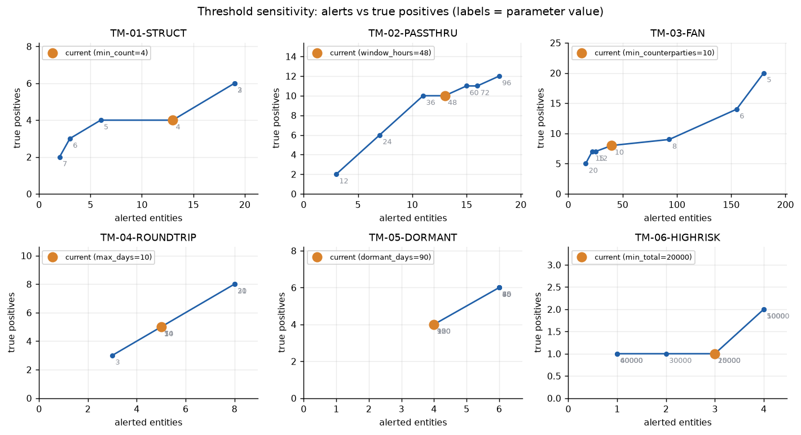
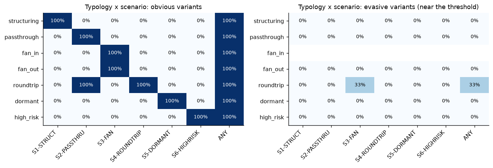
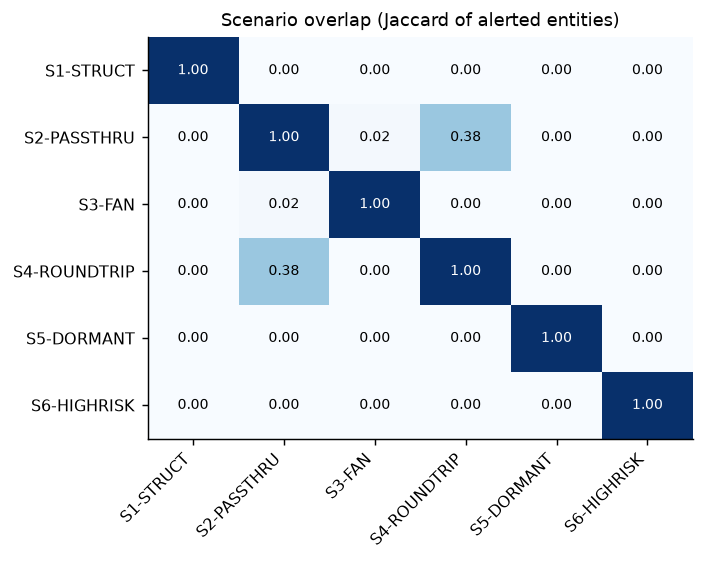
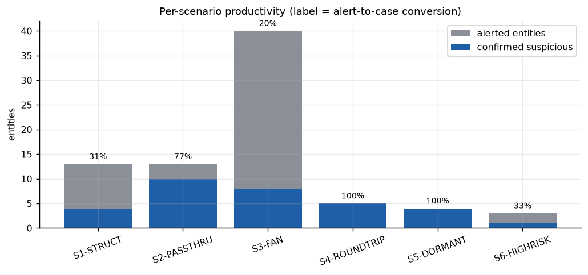
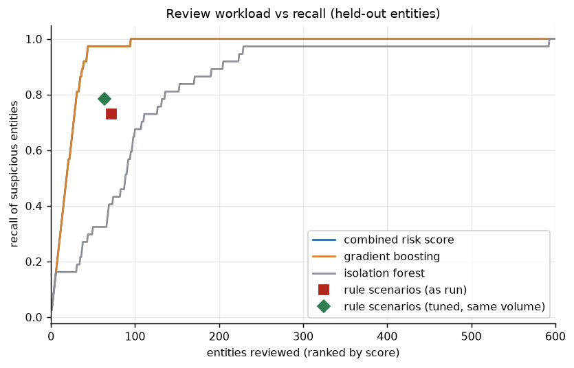
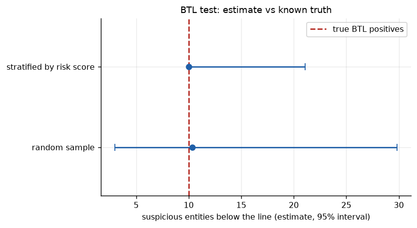

# Transaction-monitoring audit report

Generated by `tm-lab audit` from the actual run (seed 42). Data are synthetic; reviewer outcomes are taken from the injected labels, so every figure below is reproducible and none is an observation about a real institution.

## 1. Scope and approach

- Population: 762 entities in the single observation window, held-out test entities only, 37 labelled suspicious (4.9%).
- Scenarios in scope: TM-01-STRUCT, TM-02-PASSTHRU, TM-03-FAN, TM-04-ROUNDTRIP, TM-05-DORMANT, TM-06-HIGHRISK. Reporting threshold 10,000.
- Procedures: per-scenario productivity, scenario overlap, typology coverage, one-at-a-time threshold sensitivity, above-the-line (ATL) and below-the-line (BTL) sampling, and ML challenger comparison.

## 2. Summary of findings

| ID | Rating | Finding |
|---|---|---|
| F-01 | High | Low alert-to-case conversion in selected scenarios |
| F-02 | High | Suspicious activity below the line (portfolio BTL test) |
| F-03 | High | Typology coverage gaps for near-threshold (evasive) behaviour |
| F-04 | Medium | Threshold calibration against sensitivity curves |
| F-05 | Medium | Scenario overlap and unique contribution |
| F-06 | Medium | ML scoring as a challenger to rule prioritisation |
| F-07 | Medium | Rule thresholds tuned on a tuning split versus current thresholds |
| F-08 | Medium | Per-scenario BTL tests are under-powered at typical sample sizes |

## 3. Detailed findings

### F-01 Low alert-to-case conversion in selected scenarios (rating: High)

**Observation.** 3 of 6 scenarios convert fewer than half of their alerted entities into confirmed suspicious activity: TM-03-FAN 20% (8/40), TM-01-STRUCT 31% (4/13), TM-06-HIGHRISK 33% (1/3). Across all scenarios 78 entity-alerts yielded 32 confirmed (41%).

**Risk.** Analyst capacity is consumed by false positives; the institution cannot show that the threshold is a justified trade-off between workload and detection.

**Recommendation.** Segment the scenario (e.g. merchants, cash-intensive businesses) with documented rationale, re-tune against the sensitivity curves in section 3, and track conversion monthly per scenario.

### F-02 Suspicious activity below the line (portfolio BTL test) (rating: High)

**Observation.** Below-the-line population: 690 entities with no alert. A random sample of 200 contained 3 suspicious entities, extrapolating to about 10 missed entities (95% interval 3 to 30). A sample stratified by risk score estimates 10 (10 to 21). The labels show the true figure is 10, i.e. 27% of all 37 suspicious entities are not alerted. Over 500 repeated random draws the interval contained the truth 100% of the time.

**Risk.** Suspicious activity that no scenario flags is invisible to the first line and to regulators' reviews; a low BTL rate in a sample is not evidence of absence when prevalence is small.

**Recommendation.** Run a BTL sample each cycle with a stratified design (more weight near the line), document sample sizes and exceptions, and feed confirmed misses into scenario tuning.

### F-03 Typology coverage gaps for near-threshold (evasive) behaviour (rating: High)

**Observation.** Detection rate by any scenario, obvious vs evasive variant: structuring 100% vs 0%; passthrough 100% vs 0%; fan_in 100% vs nan%; fan_out 100% vs 0%; roundtrip 100% vs 33%; dormant 100% vs 0%; high_risk 100% vs 0%. Evasive variants are built to sit just under the default thresholds (for example 3 instead of 4 deposits, deposits below 80% of the reporting line, a 55-70 hour forward instead of 48, a 70-day instead of 90-day silence).

**Risk.** Customers who know or learn the thresholds can stay below them; static thresholds create a predictable blind spot.

**Recommendation.** Add behavioural or model-based challenger scenarios for the weakest typologies, vary thresholds by segment, and include near-threshold cases in the BTL test design.

### F-04 Threshold calibration against sensitivity curves (rating: Medium)

**Observation.** Settings where a different value improves F1 (precision on any suspicious entity, recall on the scenario's own typology) by more than 0.05: TM-01-STRUCT min_count=4 (F1 0.40, 13 entities, 4 TP) vs 5 (F1 0.62, 6 entities, 4 TP); TM-02-PASSTHRU window_hours=48 (F1 0.80, 13 entities, 10 TP) vs 36 (F1 0.87, 11 entities, 10 TP); TM-03-FAN min_counterparties=10 (F1 0.33, 40 entities, 8 TP) vs 15 (F1 0.47, 22 entities, 7 TP); TM-04-ROUNDTRIP max_days=10 (F1 0.77, 5 entities, 5 TP) vs 21 (F1 1.00, 8 entities, 8 TP); TM-05-DORMANT dormant_days=90 (F1 0.80, 4 entities, 4 TP) vs 30 (F1 1.00, 6 entities, 6 TP); TM-06-HIGHRISK min_total=20000 (F1 0.40, 3 entities, 1 TP) vs 5000 (F1 0.67, 4 entities, 2 TP). The sweep varies one parameter at a time and is evaluated on this dataset only.

**Risk.** Without documented sensitivity analysis a threshold cannot be defended to a regulator, and may sit on a steep part of the curve where small changes move alert volume sharply.

**Recommendation.** Keep the curves with each threshold decision, re-run after material data or product changes, and record who approved the chosen operating point and why.

### F-05 Scenario overlap and unique contribution (rating: Medium)

**Observation.** Pairs with Jaccard >= 0.15: TM-02-PASSTHRU/TM-04-ROUNDTRIP 0.38. Entities alerted by only that scenario: TM-01-STRUCT 13, TM-02-PASSTHRU 7, TM-03-FAN 39, TM-04-ROUNDTRIP 0, TM-05-DORMANT 4, TM-06-HIGHRISK 3.

**Risk.** Heavy overlap means duplicate work and overstated coverage; scenarios with no unique entities may be redundant, while unique-only scenarios carry the diversity of the programme.

**Recommendation.** Consolidate alerts per entity before case creation and review scenarios whose entire output is covered by others.

### F-06 ML scoring as a challenger to rule prioritisation (rating: Medium)

**Observation.** On held-out entities in the later window, PR-AUC is 0.95 for the tuned gradient-boosting model (95% bootstrap interval 0.90 to 0.99), 0.34 for the isolation forest, 0.95 for the combined score and 0.29 for the rules as run (prevalence 4.9%). At the rules' recall of 73% gradient boosting needs 28 reviews instead of 72 (61% fewer, interval 50% to 73%); the combined score needs 28 (61% fewer). Reviewing the top 200 below-the-line entities by risk score finds 10 suspicious entities against 2.9 expected from random selection.

**Risk.** The model is trained on labels that, in a real bank, come from past investigations and inherit the blind spots of the rules; on simulated data the numbers are optimistic. Unexplained scores are not acceptable to model-risk or audit functions.

**Recommendation.** Deploy as a challenger and prioritisation layer first (not as a replacement), keep reason codes with every score, monitor drift, and validate on out-of-time data before any threshold is relaxed.

### F-07 Rule thresholds tuned on a tuning split versus current thresholds (rating: Medium)

**Observation.** Thresholds were optimised on the earlier window's tuning entities for maximum recall within each scenario's current alert volume, then applied unchanged to the later window's held-out entities. Current thresholds alert 72 entities (recall 73%, precision 38%). Tuned at the same volume: 64 entities, recall 78%, precision 45%. Tuned to a quarter of the volume: 17 entities, recall 32%, precision 71%.

**Risk.** Thresholds set by judgement and left unreviewed carry unexplained alert volume; thresholds fitted on one period can decay when behaviour shifts.

**Recommendation.** Run threshold tuning on a tuning split with a stated alert budget at each model governance cycle, confirm on a later holdout as done here, and document the chosen operating point.

### F-08 Per-scenario BTL tests are under-powered at typical sample sizes (rating: Medium)

**Observation.** With about 150 entities sampled per scenario, 3 of 6 scenarios with misses found no exception: TM-04-ROUNDTRIP (true misses 3, needs n >= 755), TM-05-DORMANT (true misses 2, needs n >= 1134), TM-06-HIGHRISK (true misses 1, needs n >= 2273).

**Risk.** A clean BTL sample can create false assurance when the typology is rare.

**Recommendation.** State the tolerable miss rate up front and size samples with the zero-failure formula, or use risk-stratified or targeted sampling for rare typologies.

## 4. Supporting tables

### 4.1 Scenario productivity

| scenario | alerts | entities | true_positive | conversion | own_typology_hits | own_precision | own_recall |
|---|---|---|---|---|---|---|---|
| TM-01-STRUCT | 24 | 13 | 4 | 31% | 4 | 31% | 57% |
| TM-02-PASSTHRU | 25 | 13 | 10 | 77% | 5 | 38% | 83% |
| TM-03-FAN | 136 | 40 | 8 | 20% | 7 | 18% | 88% |
| TM-04-ROUNDTRIP | 8 | 5 | 5 | 100% | 5 | 100% | 62% |
| TM-05-DORMANT | 4 | 4 | 4 | 100% | 4 | 100% | 67% |
| TM-06-HIGHRISK | 4 | 3 | 1 | 33% | 1 | 33% | 50% |

### 4.2 Coverage: share of each typology detected by each scenario

| typology | TM-01-STRUCT | TM-02-PASSTHRU | TM-03-FAN | TM-04-ROUNDTRIP | TM-05-DORMANT | TM-06-HIGHRISK | ANY |
|---|---|---|---|---|---|---|---|
| structuring | 57% | 0% | 0% | 0% | 0% | 0% | 57% |
| passthrough | 0% | 83% | 0% | 0% | 0% | 0% | 83% |
| fan_in | 0% | 0% | 100% | 0% | 0% | 0% | 100% |
| fan_out | 0% | 0% | 67% | 0% | 0% | 0% | 67% |
| roundtrip | 0% | 62% | 12% | 62% | 0% | 0% | 75% |
| dormant | 0% | 0% | 0% | 0% | 67% | 0% | 67% |
| high_risk | 0% | 0% | 0% | 0% | 0% | 50% | 50% |

### 4.3 Threshold sensitivity

| scenario | parameter | value | current | entities | true_positive | precision | own_recall | f1 |
|---|---|---|---|---|---|---|---|---|
| TM-01-STRUCT | min_count | 2 |  | 19 | 6 | 0.32 | 0.86 | 0.46 |
| TM-01-STRUCT | min_count | 3 |  | 19 | 6 | 0.32 | 0.86 | 0.46 |
| TM-01-STRUCT | min_count | 4 | yes | 13 | 4 | 0.31 | 0.57 | 0.40 |
| TM-01-STRUCT | min_count | 5 |  | 6 | 4 | 0.67 | 0.57 | 0.62 |
| TM-01-STRUCT | min_count | 6 |  | 3 | 3 | 1.00 | 0.43 | 0.60 |
| TM-01-STRUCT | min_count | 7 |  | 2 | 2 | 1.00 | 0.29 | 0.44 |
| TM-02-PASSTHRU | window_hours | 12 |  | 3 | 2 | 0.67 | 0.33 | 0.44 |
| TM-02-PASSTHRU | window_hours | 24 |  | 7 | 6 | 0.86 | 0.67 | 0.75 |
| TM-02-PASSTHRU | window_hours | 36 |  | 11 | 10 | 0.91 | 0.83 | 0.87 |
| TM-02-PASSTHRU | window_hours | 48 | yes | 13 | 10 | 0.77 | 0.83 | 0.80 |
| TM-02-PASSTHRU | window_hours | 60 |  | 15 | 11 | 0.73 | 1.00 | 0.85 |
| TM-02-PASSTHRU | window_hours | 72 |  | 16 | 11 | 0.69 | 1.00 | 0.81 |
| TM-02-PASSTHRU | window_hours | 96 |  | 18 | 12 | 0.67 | 1.00 | 0.80 |
| TM-03-FAN | min_counterparties | 5 |  | 180 | 20 | 0.11 | 1.00 | 0.20 |
| TM-03-FAN | min_counterparties | 6 |  | 155 | 14 | 0.09 | 1.00 | 0.17 |
| TM-03-FAN | min_counterparties | 8 |  | 93 | 9 | 0.10 | 1.00 | 0.18 |
| TM-03-FAN | min_counterparties | 10 | yes | 40 | 8 | 0.20 | 0.88 | 0.33 |
| TM-03-FAN | min_counterparties | 12 |  | 25 | 7 | 0.28 | 0.88 | 0.42 |
| TM-03-FAN | min_counterparties | 15 |  | 22 | 7 | 0.32 | 0.88 | 0.47 |
| TM-03-FAN | min_counterparties | 20 |  | 16 | 5 | 0.31 | 0.62 | 0.42 |
| TM-04-ROUNDTRIP | max_days | 3 |  | 3 | 3 | 1.00 | 0.38 | 0.55 |
| TM-04-ROUNDTRIP | max_days | 5 |  | 5 | 5 | 1.00 | 0.62 | 0.77 |
| TM-04-ROUNDTRIP | max_days | 7 |  | 5 | 5 | 1.00 | 0.62 | 0.77 |
| TM-04-ROUNDTRIP | max_days | 10 | yes | 5 | 5 | 1.00 | 0.62 | 0.77 |
| TM-04-ROUNDTRIP | max_days | 14 |  | 5 | 5 | 1.00 | 0.62 | 0.77 |
| TM-04-ROUNDTRIP | max_days | 21 |  | 8 | 8 | 1.00 | 1.00 | 1.00 |
| TM-04-ROUNDTRIP | max_days | 30 |  | 8 | 8 | 1.00 | 1.00 | 1.00 |
| TM-05-DORMANT | dormant_days | 30 |  | 6 | 6 | 1.00 | 1.00 | 1.00 |
| TM-05-DORMANT | dormant_days | 45 |  | 6 | 6 | 1.00 | 1.00 | 1.00 |
| TM-05-DORMANT | dormant_days | 60 |  | 6 | 6 | 1.00 | 1.00 | 1.00 |
| TM-05-DORMANT | dormant_days | 75 |  | 6 | 6 | 1.00 | 1.00 | 1.00 |
| TM-05-DORMANT | dormant_days | 90 | yes | 4 | 4 | 1.00 | 0.67 | 0.80 |
| TM-05-DORMANT | dormant_days | 120 |  | 4 | 4 | 1.00 | 0.67 | 0.80 |
| TM-05-DORMANT | dormant_days | 150 |  | 4 | 4 | 1.00 | 0.67 | 0.80 |
| TM-06-HIGHRISK | min_total | 5000 |  | 4 | 2 | 0.50 | 1.00 | 0.67 |
| TM-06-HIGHRISK | min_total | 10000 |  | 4 | 2 | 0.50 | 1.00 | 0.67 |
| TM-06-HIGHRISK | min_total | 15000 |  | 3 | 1 | 0.33 | 0.50 | 0.40 |
| TM-06-HIGHRISK | min_total | 20000 | yes | 3 | 1 | 0.33 | 0.50 | 0.40 |
| TM-06-HIGHRISK | min_total | 30000 |  | 2 | 1 | 0.50 | 0.50 | 0.50 |
| TM-06-HIGHRISK | min_total | 40000 |  | 1 | 1 | 1.00 | 0.50 | 0.67 |
| TM-06-HIGHRISK | min_total | 60000 |  | 1 | 1 | 1.00 | 0.50 | 0.67 |

### 4.4 Per-scenario BTL tests

| scenario | btl_population | sample | found | est_missed | est_lo | est_hi | truth_missed | n_to_detect_at_truth |
|---|---|---|---|---|---|---|---|---|
| TM-01-STRUCT | 749 | 150 | 1 | 5.0 | 1.0 | 27.4 | 3 | 747 |
| TM-02-PASSTHRU | 749 | 150 | 1 | 5.0 | 1.0 | 27.4 | 1 | 2243 |
| TM-03-FAN | 722 | 150 | 1 | 4.8 | 1.0 | 26.4 | 1 | 2162 |
| TM-04-ROUNDTRIP | 757 | 150 | 0 | 0.0 | 0.0 | 18.4 | 3 | 755 |
| TM-05-DORMANT | 758 | 150 | 0 | 0.0 | 0.0 | 18.4 | 2 | 1134 |
| TM-06-HIGHRISK | 759 | 150 | 0 | 0.0 | 0.0 | 18.4 | 1 | 2273 |

### 4.5 Figures

---

By Utku Fidan · utkufidan.com
